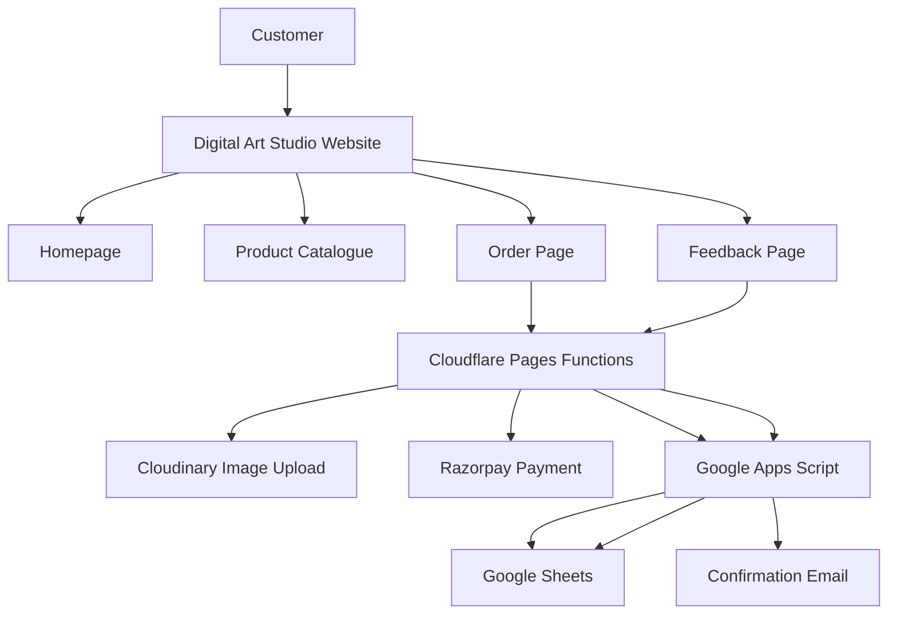

# 🎨 DviPlex – Digital Art Studio

<p align="center">
  <strong>Transform Your Memories Into Beautiful Digital Artwork</strong>
</p>

<p align="center">
  A modern digital art storefront for discovering, customizing, and ordering personalized portraits and creative illustrations.
</p>

<p align="center">
  
</p>

<p align="center">
  
  
  
  
</p>

---

## 📌 Table of Contents

1. [Introduction](#-introduction)
2. [Project Overview](#-project-overview)
3. [Key Features](#-key-features)
4. [Artwork Categories](#-artwork-categories)
5. [Technology Stack](#-technology-stack)
6. [System Architecture](#-system-architecture)
7. [Project Structure](#-project-structure)
8. [Application Workflow](#-application-workflow)
9. [Backend and API Documentation](#-backend-and-api-documentation)
10. [Database and Storage](#-database-and-storage)
11. [Payment Integration](#-payment-integration)
12. [Image Upload System](#-image-upload-system)
13. [Email Notification System](#-email-notification-system)
14. [Customer Feedback System](#-customer-feedback-system)
15. [Installation and Setup](#-installation-and-setup)
16. [Environment Configuration](#-environment-configuration)
17. [Deployment](#-deployment)
18. [Security Considerations](#-security-considerations)
19. [Future Enhancements](#-future-enhancements)
20. [Contributing](#-contributing)
21. [License](#-license)
22. [Repository](#-repository)

---

## 🎨 Introduction

**DviPlex – Digital Art Studio** is a web-based digital artwork platform designed to make personalized artwork accessible to everyone.

The platform provides customers with a convenient way to explore creative artwork styles, select their preferred designs, submit customization requirements, upload reference photographs, and place orders online.

Digital Art Studio focuses on turning ordinary photographs and memorable moments into personalized digital illustrations suitable for gifts, decorations, celebrations, and personal collections.

The platform combines a responsive frontend, serverless backend services, cloud-based image storage, online payment processing, and spreadsheet-based order management to provide an integrated ordering experience.

## 🚀 Project Overview

The primary objective of this project is to develop a digital storefront that simplifies the process of ordering customized artwork.

Instead of handling customer requirements manually through separate communication channels, the platform provides a centralized ordering workflow.

### Project Objectives

- Build an attractive and responsive digital artwork website.
- Display artwork collections with descriptions and pricing.
- Provide a structured custom-ordering experience.
- Allow customers to upload reference images.
- Integrate online payment processing.
- Automate order storage and management.
- Send customer order confirmation emails.
- Collect customer ratings and feedback.
- Maintain a centralized record of customer orders.

### Target Users

- Individuals looking for personalized digital portraits.
- Couples and families looking for customized artwork.
- Customers searching for creative gifts.
- Pet owners interested in personalized pet illustrations.
- Customers interested in digital illustrations and creative designs.

---

## ✨ Key Features

### 1. Responsive Homepage

- Modern and visually appealing user interface.
- Responsive navigation.
- Artwork showcase and promotional sections.
- Product discovery and browsing.
- Navigation to ordering and other website pages.
- Links to external shopping platforms.

### 2. Dynamic Product Catalogue

The product catalogue is maintained separately in `products_catalog.js`.

Each product can contain:

- Product title.
- Artwork category.
- Product description.
- Product images.
- Thumbnail image.
- Original price.
- Selling price.
- Customer rating.
- Review count.

The catalogue uses structured JavaScript objects, making it easier to maintain and update product information.

### 3. Custom Order Management

Customers can submit their artwork requirements through the dedicated order page.

The order workflow supports:

- Customer name.
- Email address.
- WhatsApp number.
- Selected artwork style.
- Product information and price.
- Name to appear in the artwork.
- Artwork size.
- Font preferences.
- Artwork colour preferences.
- Border style.
- Custom text and signature.
- Special instructions.
- Reference image uploads.

### 4. Cloud-Based Image Upload

Customers can upload their reference photographs through the ordering form.

The upload system:

- Accepts JPEG, JPG, PNG, WebP, HEIC and HEIF formats.
- Supports images up to 10 MB each.
- Validates file formats and sizes.
- Generates secure Cloudinary upload signatures on the server.
- Uploads images to Cloudinary.
- Returns secure image URLs for order storage.

The Google Apps Script order structure provides six image URL fields.

### 5. Online Payment Processing

The project includes Razorpay integration for initiating payments and verifying payment signatures.

Payment features include:

- Payment order creation.
- INR currency support.
- Razorpay API integration.
- Payment signature verification.
- Server-side credential management.
- Mock payment fallback when payment credentials are not configured.

### 6. Automated Order Storage

Order information is forwarded through Cloudflare Pages Functions to Google Apps Script.

Google Sheets is used to maintain customer order records.

The backend dynamically maps submitted information to spreadsheet headers, allowing columns to be rearranged without relying on fixed column positions.

### 7. Customer Email Notifications

The Google Apps Script backend includes order confirmation email functionality.

The email template includes:

- Customer name.
- Order number.
- Artwork title.
- Feedback link.
- Delivery-related communication.

The repository also contains `delivery_email_template.txt` for the customer notification template.

### 8. Customer Feedback and Reviews

Customers can submit feedback through a dedicated feedback page.

Features include:

- Order-linked feedback.
- Five-star rating selection.
- Optional written reviews.
- Customer feedback submission.
- Feedback storage in Google Sheets.
- Retrieval of feedback records.

### 9. Privacy Policy

The website includes a dedicated privacy policy page describing information handling and third-party services.

---

## 🖼️ Artwork Categories

The product catalogue includes different types of personalized artwork.

Examples of catalogue categories and product styles include:

| Category | Examples |
|---|---|
| Anime Portrait | Couple, Cat, Dog, Family, Friends |
| Caricature Portrait | Birthday, Couple, Family, Pets |
| Line Art Portrait | Couple, Cat, Dog, Family |

Product information, pricing, images and descriptions are maintained in the product catalogue.

---

## 🛠️ Technology Stack

| Technology | Purpose |
|---|---|
| HTML5 | Website structure |
| CSS3 | Styling and responsive layouts |
| JavaScript | Frontend functionality |
| Cloudflare Pages | Website hosting |
| Cloudflare Pages Functions | Serverless backend APIs |
| Google Apps Script | Backend processing |
| Google Sheets | Order and feedback database |
| Cloudinary | Cloud image storage |
| Razorpay | Payment processing |
| Node.js 18+ | Supported development runtime |
| Git & GitHub | Version control and source management |

### Why This Architecture?

The project uses a lightweight serverless architecture to avoid maintaining a continuously running backend server.

Cloudflare Pages hosts the website and executes backend functions, while Google Apps Script and Google Sheets provide order-management functionality.

Cloudinary handles image storage independently of the website hosting environment.

---

## 🏗️ System Architecture



### Architecture Components

**Frontend Layer**

Provides the customer-facing website, product gallery, order forms and feedback interface.

**API Layer**

Cloudflare Pages Functions process requests from the frontend and communicate with external services.

**Storage Layer**

Cloudinary stores uploaded customer images, while Google Sheets stores order and feedback information.

**Payment Layer**

Razorpay handles online payment order creation and payment verification.

**Automation Layer**

Google Apps Script handles spreadsheet operations and order confirmation emails.

---

## 📁 Project Structure

```text
DviPlex/
│
├── Images/
│   └── Website images, logos and visual assets
│
├── Products/
│   └── Digital artwork product images
│
├── functions/
│   └── api/
│       ├── upload-images.js
│       ├── save-order.js
│       ├── start-payment.js
│       ├── verify-payment.js
│       ├── get-order.js
│       ├── save-feedback.js
│       └── send-email.js
│
├── js/
│   └── config.js
│
├── index.html
│   └── Main website homepage
│
├── order.html
│   └── Customer order page
│
├── feedback.html
│   └── Customer feedback page
│
├── privacy-policy.html
│   └── Privacy policy page
│
├── products_catalog.js
│   └── Product catalogue configuration
│
├── google-apps-script.js
│   └── Google Sheets and order backend
│
├── delivery_email_template.txt
│   └── Customer email template
│
├── replace_text.py
│   └── Text replacement utility
│
├── package.json
│   └── Project metadata and runtime requirement
│
└── README.md
    └── Project documentation
```

---

## 🔄 Application Workflow

### Customer Ordering Process

1. Customer visits the Digital Art Studio website.
2. Customer browses the available artwork.
3. Customer selects a preferred product.
4. Customer proceeds to the order page.
5. Customer enters personal information.
6. Customer selects customization options.
7. Customer uploads reference photographs.
8. Uploaded images are sent to Cloudinary.
9. Customer proceeds through the payment workflow.
10. Payment information is processed through Razorpay.
11. The order is submitted to the Cloudflare API.
12. Google Apps Script stores the order in Google Sheets.
13. The backend triggers an order confirmation email.
14. Customer can later submit feedback using the provided feedback link.

---

## ⚙️ Backend and API Documentation

The project uses Cloudflare Pages Functions for backend operations.

All frontend API endpoint paths are centrally maintained in:

`js/config.js`

### Available API Endpoints

| Endpoint | Method | Function |
|---|---|---|
| `/api/upload-images` | POST | Upload customer images |
| `/api/save-order` | POST | Save customer orders |
| `/api/start-payment` | POST | Initiate Razorpay payments |
| `/api/verify-payment` | POST | Verify payment signatures |
| `/api/get-order` | GET | Retrieve order details |
| `/api/save-feedback` | POST | Save customer feedback |
| `/api/send-email` | POST | Email gateway compatibility endpoint |

### API Responsibilities

**Image Upload API**

`functions/api/upload-images.js`

Processes multipart form data, validates image files, generates Cloudinary signatures and returns secure image URLs.

**Order API**

`functions/api/save-order.js`

Validates customer information and forwards the order payload to Google Apps Script.

**Payment Initiation API**

`functions/api/start-payment.js`

Creates a Razorpay order using the configured server-side credentials.

**Payment Verification API**

`functions/api/verify-payment.js`

Verifies the Razorpay payment signature using HMAC SHA-256.

**Order Retrieval API**

`functions/api/get-order.js`

Retrieves an existing order using its order ID.

**Feedback API**

`functions/api/save-feedback.js`

Forwards customer ratings and review information to Google Apps Script.

**Email API**

`functions/api/send-email.js`

Provides a compatibility endpoint for email dispatch. The primary order confirmation email is triggered directly by Google Apps Script during order saving.

---

## 🗄️ Database and Storage

The project uses Google Sheets as its primary order and feedback storage system.

### Order Sheet

The order sheet maintains information such as:

- Order ID.
- Order date.
- Customer details.
- WhatsApp number.
- Email address.
- Artwork style.
- Product name.
- Product price.
- Customization information.
- Uploaded image URLs.
- Payment status.
- Payment ID.
- Order status.
- Confirmation email status.
- Feedback link.

### Feedback Sheet

The feedback functionality maintains:

- Order ID.
- Customer rating.
- Customer review.

### Dynamic Column Mapping

The Google Apps Script backend reads spreadsheet headers and dynamically maps submitted fields to the appropriate columns.

This makes the system more flexible when spreadsheet columns are rearranged or additional columns are introduced.

---

## 💳 Payment Integration

Razorpay is integrated to support online payments in Indian Rupees (INR).

### Payment Workflow

1. Frontend submits the transaction amount.
2. Cloudflare creates a Razorpay order.
3. Razorpay returns an order ID.
4. The payment flow proceeds using the generated order.
5. Payment details are returned to the application.
6. Cloudflare verifies the payment signature.
7. The verification result is returned to the frontend.

### Required Credentials

- Razorpay Key ID.
- Razorpay Key Secret.

**Important:** The payment initiation API contains a mock-payment fallback when Razorpay credentials are missing. Mock payments must never be treated as real payments or used for production order fulfilment.

---

## ☁️ Image Upload System

Cloudinary is used for storing customer-uploaded reference images.

### Supported Image Formats

- JPG
- JPEG
- PNG
- WebP
- HEIC
- HEIF

### Upload Restrictions

- Maximum file size: 10 MB per image.
- Maximum image URL slots in the order spreadsheet: 6.

### Upload Workflow

```text
Customer selects images
        |
        v
Frontend submits multipart data
        |
        v
Cloudflare validates files
        |
        v
Cloudinary signature generated
        |
        v
Images uploaded to Cloudinary
        |
        v
Secure image URLs returned
        |
        v
Image URLs attached to order
```

---

## 📧 Email Notification System

Google Apps Script is responsible for triggering order confirmation emails when an order is saved.

The email template is maintained in:

`delivery_email_template.txt`

The template supports the following placeholders:

- `{{customer_name}}`
- `{{order_id}}`
- `{{product_title}}`
- `{{feedback_link}}`

The confirmation email informs customers that their artwork order has been received and provides a link to submit feedback.

---

## ⭐ Customer Feedback System

The feedback page provides customers with an opportunity to share their experience after receiving their artwork.

### Feedback Features

- Five-star rating selection.
- Optional written comments.
- Order ID validation.
- Product information retrieval.
- Feedback submission.
- Google Sheets storage.
- Success and error notifications.

Feedback is associated with the corresponding order ID, allowing the backend to connect reviews with the relevant product and order.

---

## 💻 Installation and Setup

### Prerequisites

Install the following tools before starting development:

- Git
- Node.js 18 or higher
- Visual Studio Code
- A modern web browser
- Cloudflare account
- Google account
- Cloudinary account
- Razorpay account (for live payment integration)

### Step 1: Clone the Repository

```bash
git clone https://github.com/gandha-24/DviPlex.git
```

### Step 2: Open the Project

```bash
cd DviPlex
```

Open the folder in Visual Studio Code:

```bash
code .
```

### Step 3: Configure the Backend

Configure the required Google Apps Script, Google Sheets, Cloudinary and Razorpay integrations.

### Step 4: Run the Website Locally

The frontend consists of static HTML, CSS and JavaScript files.

You can use the VS Code Live Server extension to preview the static pages.

For local testing of Cloudflare Pages Functions, use Wrangler:

```bash
npx wrangler pages dev .
```

Note that backend integrations require their environment variables and external services to be configured before they can work locally.

---

## 🔐 Environment Configuration

The following environment variables are referenced by the backend functions.

Configure them in the Cloudflare Pages project settings under the appropriate environment.

| Variable | Purpose |
|---|---|
| `GOOGLE_SCRIPT_URL` | Google Apps Script deployed Web App URL |
| `CLOUDINARY_CLOUD_NAME` | Cloudinary cloud name |
| `CLOUDINARY_API_KEY` | Cloudinary API key |
| `CLOUDINARY_API_SECRET` | Cloudinary API secret |
| `CLOUDINARY_UPLOAD_PRESET` | Optional Cloudinary upload preset |
| `RAZORPAY_KEY_ID` | Razorpay public key identifier |
| `RAZORPAY_KEY_SECRET` | Razorpay secret key |

**Security Guidelines**

- Never commit API secrets to GitHub.
- Keep sensitive credentials in Cloudflare environment variables.
- Use separate test and production credentials.
- Never expose Cloudinary API secrets or Razorpay secret keys in frontend JavaScript.
- Rotate credentials if they are accidentally exposed.

---

## 🚀 Deployment

The application is designed for deployment using Cloudflare Pages.

### Step 1: Push the Repository to GitHub

```bash
git add .
git commit -m "Update Digital Art Studio"
git push origin main
```

### Step 2: Create a Cloudflare Pages Project

1. Log in to Cloudflare.
2. Navigate to Workers & Pages.
3. Select Create Application.
4. Choose Pages.
5. Connect your GitHub account.
6. Select the DviPlex repository.
7. Select the `main` branch.

### Step 3: Configure Build Settings

The project is primarily static and does not require a frontend build command.

Suggested configuration:

| Setting | Value |
|---|---|
| Framework preset | None |
| Build command | Leave empty |
| Build output directory | `/` |
| Root directory | `/` |

### Step 4: Configure Environment Variables

Add the required Cloudinary, Razorpay and Google Apps Script environment variables.

### Step 5: Deploy

Start the Cloudflare Pages deployment.

After successful deployment, Cloudflare will provide a website URL.

### Step 6: Verify the Application

Check the following:

- Homepage loads correctly.
- Product images display properly.
- Product catalogue works.
- Order form loads.
- Image upload works.
- Payment integration works with test credentials.
- Orders are stored in Google Sheets.
- Confirmation emails are triggered.
- Feedback submissions are saved.

---

## 🔒 Security Considerations

Security is important because the application processes customer information, uploaded images and payment-related information.

Recommended practices:

1. Store sensitive API credentials only on the server.
2. Validate all incoming customer information.
3. Validate image formats and file sizes.
4. Verify payment signatures on the server.
5. Use HTTPS for production deployment.
6. Avoid exposing spreadsheet credentials.
7. Restrict access to the Google spreadsheet.
8. Review Cloudflare API logs for unexpected requests.
9. Implement appropriate request rate limiting.
10. Verify payment status independently before fulfilling orders.

The current payment verification endpoint verifies Razorpay signatures; production fulfilment should additionally confirm the actual payment status before marking an order as paid.

---

## 🔮 Future Enhancements

Potential improvements for future versions include:

- Dedicated administrator dashboard.
- Real-time order tracking.
- Advanced order status management.
- Customer accounts and order history.
- Automated artwork delivery.
- WhatsApp order notifications.
- Advanced product filtering and search.
- Customer review display on product pages.
- Analytics and sales reports.
- Improved payment reconciliation.
- Automated invoice generation.
- Enhanced image processing and previews.
- Inventory and product management.

---

## 🤝 Contributing

Contributions, suggestions and improvements are welcome.

To contribute:

1. Fork the repository.
2. Create a new feature branch.
3. Make your changes.
4. Test the application.
5. Commit your changes.
6. Push your branch.
7. Submit a Pull Request.

Example:

```bash
git checkout -b feature/new-feature

git add .

git commit -m "Add new feature"

git push origin feature/new-feature
```

---

## 📄 License

No LICENSE file was identified in the repository during documentation review.

The licensing terms should be confirmed by the repository owner before redistribution or reuse.

---

## 🔗 Repository

**GitHub Repository:**

https://github.com/gandha-24/DviPlex

**Project Name:** DviPlex – Digital Art Studio

**Primary Branch:** `main`

---

<p align="center">
  <strong>Digital Art Studio</strong>
  <br/>
  Turning Memories Into Art.
  <br/><br/>
  Made with creativity and technology.
</p>
